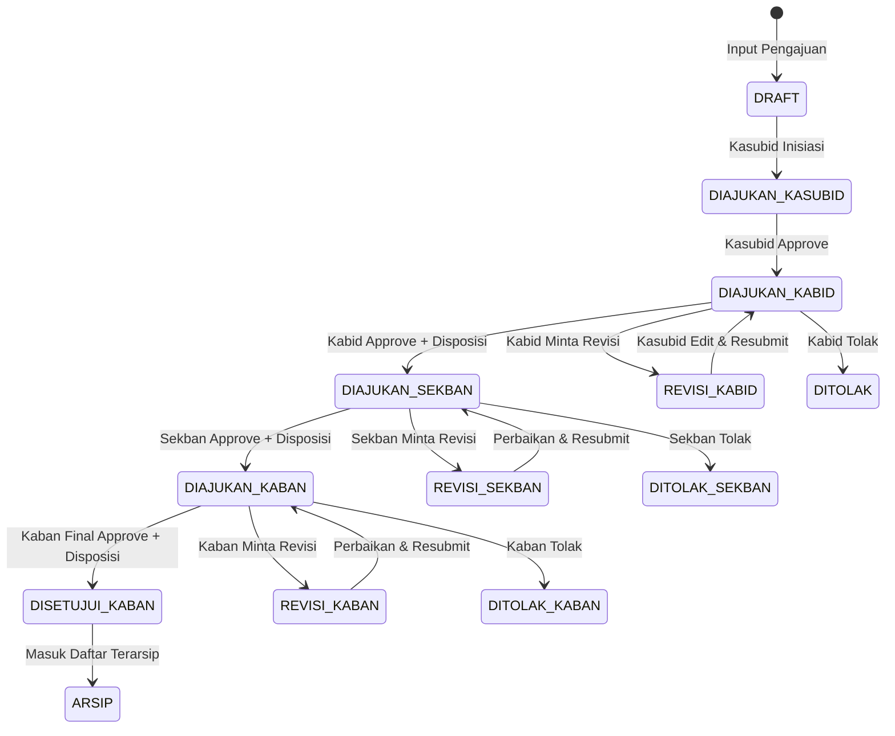
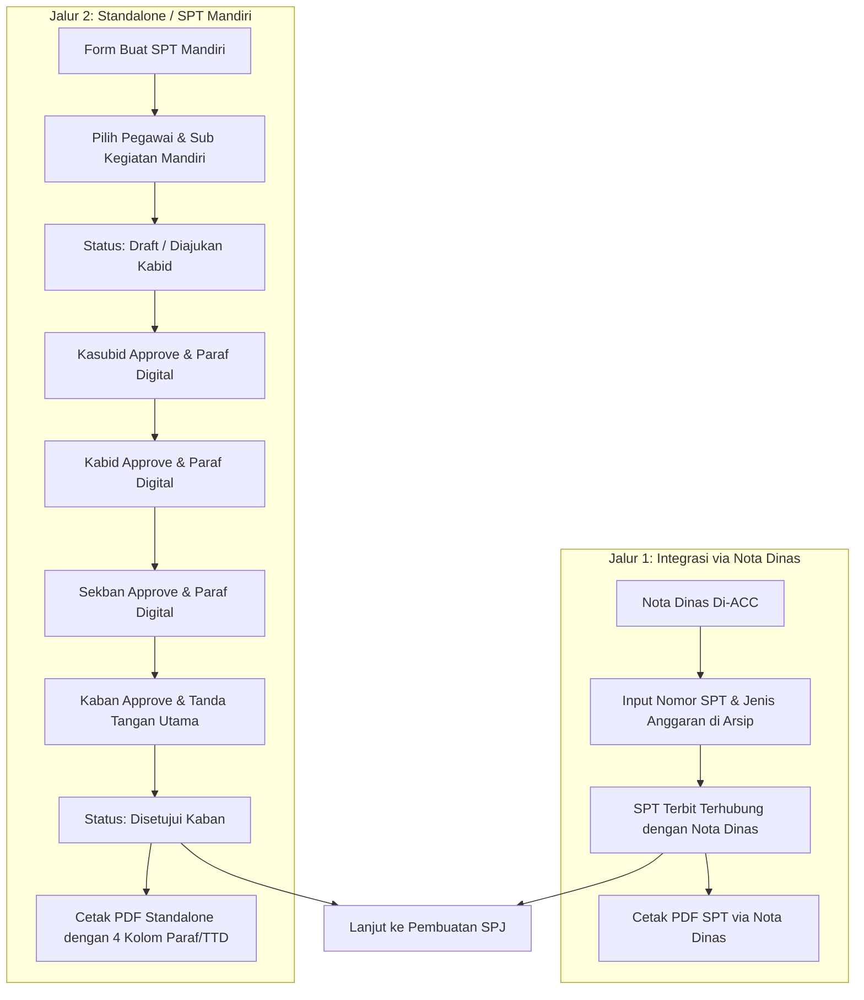
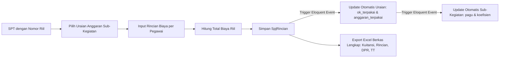
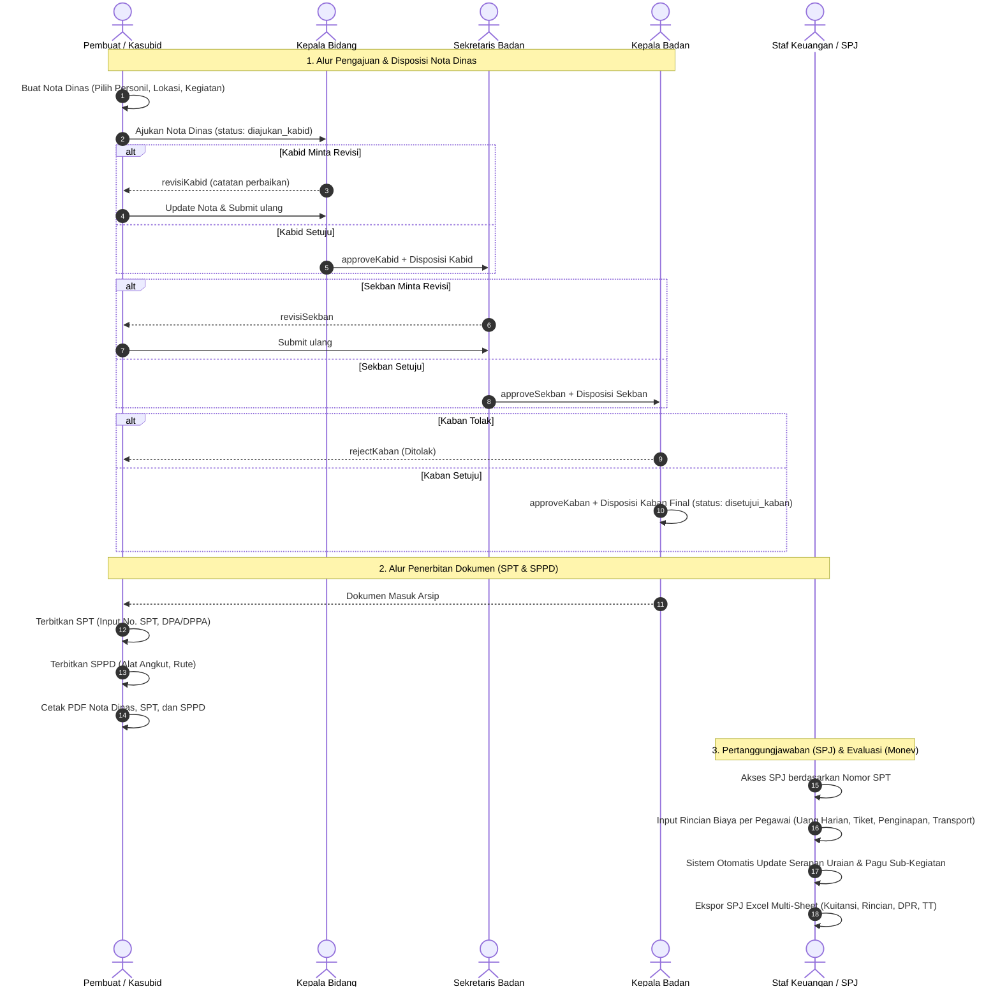

# Dokumentasi Business Flow Aplikasi Pengelolaan SPT, SPPD, dan SPJ

Dokumen ini menyajikan analisis menyeluruh terhadap alur bisnis (*business flow*), aturan validasi (*business logic*), hierarki otorisasi (*role & data scoping*), dan integrasi antar-modul yang telah diimplementasikan di dalam source code aplikasi.

---

## Daftar Isi
1. [Gambaran Umum Sistem & Arsitektur](#1-gambaran-umum-sistem--arsitektur)
2. [Hierarki Organisasi & Matriks Peran (Role-Based Access Control)](#2-hierarki-organisasi--matriks-peran-role-based-access-control)
3. [Manajemen Master Data](#3-manajemen-master-data)
4. [Alur Bisnis Nota Dinas & Disposisi Berjenjang](#4-alur-bisnis-nota-dinas--disposisi-berjenjang)
5. [Alur Pengarsipan Dokumen (Arsip)](#5-alur-pengarsipan-dokumen-arsip)
6. [Alur Bisnis Surat Perintah Tugas (SPT)](#6-alur-bisnis-surat-perintah-tugas-spt)
7. [Alur Bisnis Surat Perintah Perjalanan Dinas (SPPD)](#7-alur-bisnis-surat-perintah-perjalanan-dinas-sppd)
8. [Alur Bisnis SPJ & Rekapitulasi Biaya Riil](#8-alur-bisnis-spj--rekapitulasi-biaya-riil)
9. [Alur Monitoring dan Evaluasi (Monev) Anggaran](#9-alur-monitoring-dan-evaluasi-monev-anggaran)
10. [Alur Dashboard, Statistik, & Rekapitulasi Tahunan](#10-alur-dashboard-statistik--rekapitulasi-tahunan)
11. [Diagram Alur End-to-End (Mermaid)](#11-diagram-alur-end-to-end-mermaid)

---

## 1. Gambaran Umum Sistem & Arsitektur

Aplikasi dirancang untuk mengotomatisasi siklus hidup administrasi perjalanan dinas pada instansi pemerintah daerah (khususnya Bidang Anggaran / BPKAD), mulai dari:
1. Pengajuan Nota Dinas Perjalanan Dinas beserta personil dan disposisi berjenjang.
2. Penerbitan Surat Perintah Tugas (SPT) dan Surat Perintah Perjalanan Dinas (SPPD).
3. Pengelolaan Surat Pertanggungjawaban (SPJ) pengeluaran riil (tiket, transport, uang harian, dan penginapan).
4. Monitoring dan evaluasi realisasi pagu anggaran per sub-kegiatan dan target Orang-Kegiatan (OK).
5. Pencetakan dokumen resmi berbasis PDF berstandar dan ekspor berkas kuitansi SPJ format Excel multi-sheet.

### Komponen Teknologi Utama
- **Backend Framework**: Laravel 11.x (PHP >= 8.2)
- **Database**: MySQL / MariaDB dengan relasi Eloquent ORM
- **Export PDF**: `barryvdh/laravel-dompdf` (DomPDF)
- **Export & Import Excel**: `phpoffice/phpspreadsheet`
- **Frontend Layer**: Blade Templating, TailwindCSS (TailAdmin Theme), Alpine.js

---

## 2. Hierarki Organisasi & Matriks Peran (Role-Based Access Control)

Sistem menerapkan prinsip *Multi-Tenancy Organisasi Berjenjang* dan *Row-Level Data Scoping* berdasarkan struktur:
$$\text{Dinas (Instansi)} \longrightarrow \text{Bidang} \longrightarrow \text{Sub Bidang}$$

### 2.1. Daftar Peran (Roles)
Terdapat 7 peran pengguna yang terdaftar di dalam sistem (`roles` table):
1. **`super_admin`**: Administrator sistem level tertinggi dengan akses tak terbatas lintas dinas, bidang, dan konfigurasi master data.
2. **`admin`**: Administrator level dinas/bidang yang mengelola master pegawai, akun pengguna di dinasnya, dan sub kegiatan.
3. **`kepala_badan`** (Kaban): Pimpinan dinas/instansi tertinggi yang memberikan disposisi akhir dan tanda tangan utama dokumen dinas.
4. **`sekretaris_badan`** (Sekban): Pejabat vertikal yang memverifikasi pengajuan dan memberikan catatan disposisi sebelum ke Kepala Badan.
5. **`kepala_bidang`** (Kabid): Pimpinan tingkat bidang yang memverifikasi nota dinas staf dan sub-kegiatan di bawah bidangnya.
6. **`kepala_sub_bidang`** (Kasubid): Pemimpin operasional sub-bidang / PPTK yang menginisiasi pengajuan nota dinas, mengelola uraian pagu, dan paraf awal.
7. **`user`**: Staf umum pelaksana perjalanan dinas.

### 2.2. Row-Level Data Scoping Rules
Setiap query data operasional disaring secara dinamis berdasarkan atribut pengguna yang sedang login:
- **Pengguna `super_admin`**: Tanpa batasan scope (`whereRaw` tidak diterapkan).
- **Pengguna `kepala_badan` & `sekretaris_badan`**: Dibatasi oleh `dinas_id` pengguna (`where('dinas_id', $user->dinas_id)`).
- **Pengguna `kepala_bidang` & `admin`**: Dibatasi oleh `bidang_id` pengguna (`where('bidang_id', $user->bidang_id)`).
- **Pengguna `kepala_sub_bidang`**: Dibatasi oleh `sub_bidang_id` pengguna (`where('sub_bidang_id', $user->sub_bidang_id)`). Jika akun belum dipetakan ke `sub_bidang_id`, query mengembalikan hasil kosong (`whereRaw('1 = 0')`).

### 2.3. Matriks Hak Akses Modul

| Modul / Fitur | Super Admin | Admin | Kasubid | Kabid | Sekban | Kaban | User |
| :--- | :---: | :---: | :---: | :---: | :---: | :---: | :---: |
| **Dashboard & Rekap** | ✓ | ✓ | ✓ | ✓ | ✓ | ✓ | - |
| **Master Dinas & Bidang** | ✓ | - | - | - | - | - | - |
| **Master Pegawai & Akun** | ✓ | ✓ | - | - | - | - | - |
| **Master Sub-Kegiatan** | ✓ | ✓ | ✓ | - | - | - | ✓ |
| **Nota Dinas (Buat/Edit)** | ✓ | ✓ | ✓ | ✓ | - | - | - |
| **Approve Nota Kasubid** | ✓ | - | ✓ | - | - | - | - |
| **Disposisi / Approve Kabid** | ✓ | - | - | ✓ | - | - | - |
| **Disposisi / Approve Sekban** | ✓ | - | - | - | ✓ | - | - |
| **Disposisi / Approve Kaban** | ✓ | - | - | - | - | ✓ | - |
| **Arsip Dokumen** | ✓ | ✓ | ✓ | ✓ | ✓ | ✓ | - |
| **SPT via Nota & Standalone** | ✓ | ✓ | ✓ | ✓ | ✓ | ✓ | ✓ |
| **Paraf Digital Berjenjang SPT** | ✓ | - | ✓ | ✓ | ✓ | ✓ | - |
| **SPPD (Buat & Cetak PDF)** | ✓ | ✓ | ✓ | ✓ | ✓ | ✓ | ✓ |
| **SPJ (Input Biaya & Export XLS)** | ✓ | ✓ | ✓ | ✓ | ✓ | ✓ | ✓ |
| **Monev & Uraian Anggaran** | ✓ | ✓ | ✓ | ✓ | ✓ | ✓ | - |

---

## 3. Manajemen Master Data

### 3.1. Struktur Institusi (Dinas, Bidang, Sub-Bidang)
- **Controller**: [DinasController](file:///d:/Rakha/app-spt/app/Http/Controllers/DinasController.php), [BidangController](file:///d:/Rakha/app-spt/app/Http/Controllers/BidangController.php), [SubBidangController](file:///d:/Rakha/app-spt/app/Http/Controllers/SubBidangController.php)
- **Fitur Utama**:
  - CRUD master dinas, bidang, dan sub-bidang.
  - Unduh template Excel (`.xlsx`) dan impor masal Dinas dengan validasi duplikasi per baris.
  - Endpoint AJAX dinamis (`/api/bidang/{dinas_id}`) untuk cascading dropdown form pegawai/akun.

### 3.2. Master Pegawai
- **Controller**: [PegawaiController](file:///d:/Rakha/app-spt/app/Http/Controllers/PegawaiController.php)
- **Model**: [Pegawai](file:///d:/Rakha/app-spt/app/Models/Pegawai.php)
- **Atribut**: `nama`, `nip` (unik), `pangkat`, `jabatan`, `dinas_id`, `bidang_id`.
- **Fitur**:
  - Impor berkas Excel (`/pegawai/import`) dan unduh template resmi.
  - Auto-scoping: Admin hanya dapat menambahkan pegawai ke dinas dan bidang yang sesuai dengan profil akunnya.

### 3.3. Master Pengguna & Tanda Tangan Digital (Signature)
- **Controller**: [UserController](file:///d:/Rakha/app-spt/app/Http/Controllers/UserController.php), [AuthController](file:///d:/Rakha/app-spt/app/Http/Controllers/AuthController.php)
- **Model**: [User](file:///d:/Rakha/app-spt/app/Models/User.php)
- **Autentikasi Bertingkat**:
  - Pengguna umum wajib memilih `dinas` saat login agar akun terisolasi sesuai instansi kerjanya.
  - Khusus pengguna khusus `superadmin00`, seleksi dinas dilewati untuk kemudahan administrasi global.
- **Tanda Tangan & Paraf Digital**:
  - Admin/User dapat mengunggah file tanda tangan/paraf (`signature_path`) berupa berkas gambar (PNG/JPG maks 1 MB).
  - Tanda tangan ini disimpan di `public/images/signatures/` dan digunakan secara otomatis pada paraf approval SPT digital dan cetak PDF.

### 3.4. Master Sub-Kegiatan & PPTK
- **Controller**: [SubKegiatanController](file:///d:/Rakha/app-spt/app/Http/Controllers/SubKegiatanController.php)
- **Model**: [SubKegiatan](file:///d:/Rakha/app-spt/app/Models/SubKegiatan.php)
- **Logika Otomatisasi PPTK**:
  - Sub-kegiatan dihubungkan dengan Pejabat Pelaksana Teknis Kegiatan (PPTK).
  - Sistem memiliki logika penentuan otomatis (`getPptkNamaAttribute()`): jika terdapat `sub_bidang_id`, sistem secara cerdas mencari akun pengguna dengan role `kepala_sub_bidang` pada sub-bidang tersebut untuk dijadikan PPTK secara otomatis.

---

## 4. Alur Bisnis Nota Dinas & Disposisi Berjenjang

Nota Dinas merupakan pintu masuk utama pengajuan perjalanan dinas dalam alur reguler. Modul ini memiliki workflow persetujuan multi-level dengan catatan disposisi dinamis.

### 4.1. Tahap Inisiasi (Store & Create)
1. **Pembuat Nota** (Kasubid/Admin) memilih:
   - Sub-Kegiatan (hanya yang dalam lingkup sub-bidang/bidang user).
   - Pejabat Penerima (`kepada_id`), Pengirim (`dari_id`), dan Perantara (`melalui_id`).
   - Perihal, Lokasi Tujuan, Jenis Perjalanan (`dalam_daerah` atau `luar_daerah`).
   - Rentang Tanggal (`tanggal_mulai` s.d. `tanggal_selesai`).
   - Personil yang ditugaskan (`pegawai_ids[]` disimpan ke tabel pivot `nota_dinas_pegawai`).
   - Lampiran, Sifat Surat, Asal Undangan, dan Uraian Kegiatan.
2. Nota tersimpan langsung dengan status awal `diajukan_kabid` (atau `draft` jika diinisiasi oleh staf).

### 4.2. Tahap Verifikasi & Disposisi Kabid
- **Aksi Persetujuan (`approveKabid`)**: Kabid memeriksa substansi perjalanan dinas, menambahkan Catatan Disposisi Kabid (`disposisi_kabid`), sistem mencatat `tanggal_disposisi_kabid = now()` dan memindahkan status ke `diajukan_sekban`.
- **Aksi Revisi (`revisiKabid`)**: Kabid mengisi catatan perbaikan minimal 5 karakter (`revisi`). Status berubah menjadi `revisi_kabid`. Pembuat nota dapat memperbarui data nota dinas yang otomatis mereset status kembali ke `diajukan_kabid`.
- **Aksi Penolakan (`rejectKabid`)**: Status nota dinas berubah menjadi `ditolak`.

### 4.3. Tahap Verifikasi & Disposisi Sekretaris Badan (Sekban)
- **Aksi Persetujuan (`approveSekban`)**: Sekban memberikan Catatan Disposisi Sekban (`disposisi_sekban`), sistem mencatat `tanggal_disposisi_sekban = now()` dan memindahkan status ke `diajukan_kaban`.
- **Aksi Revisi (`revisiSekban`)**: Status menjadi `revisi_sekban` disertai pesan perbaikan.
- **Aksi Penolakan (`rejectSekban`)**: Status menjadi `ditolak_sekban`.

### 4.4. Tahap Persetujuan Akhir Kepala Badan (Kaban)
- **Aksi Persetujuan Final (`approveKaban`)**: Kaban memberikan instruksi disposisi final (`disposisi_kaban`), mencatat `tanggal_disposisi_kaban = now()`, dan mengubah status menjadi `disetujui_kaban`.
- Dokumen dengan status ini terkunci dari edit/hapus dan secara otomatis memenuhi syarat untuk penerbitan SPT, SPPD, serta masuk ke modul **Arsip**.

### 4.5. Cetak & Pratinjau Nota Dinas
- **Preview Halaman** (`/nota-dinas/{nota}/preview`): Menampilkan ringkasan nota, grouping daftar personil berdasarkan jabatan, serta timeline lengkap disposisi Kabid, Sekban, dan Kaban.
- **Cetak PDF Resmi** (`/nota-dinas/{nota}/cetak`): Menghasilkan lembar fisik PDF format A4 Portrait berisi format surat dinas resmi, daftar personil, dan kolom disposisi bertingkat.

---

## 5. Alur Pengarsipan Dokumen (Arsip)

Modul Arsip (`/arsip`) bertindak sebagai pusat repositori dan *action hub* untuk dokumen nota dinas yang telah disetujui.

### 5.1. Kriteria Dokumen Masuk Arsip
Query filter arsip hanya mengambil Nota Dinas dengan status:
- `disetujui_kaban` (Persetujuan penuh level dinas)
- `disetujui_kabid` (Untuk instansi/bidang tertentu yang otoritas akhirnya di tingkat bidang)

### 5.2. Aksi Cepat (Quick Actions) dari Arsip
Dari satu baris nota dinas terarsip, pengguna berwenang dapat langsung:
1. **Mencetak Nota Dinas PDF** yang telah disetujui.
2. **Membuat SPT Terhubung**: Membuka modal input Nomor SPT dan Jenis Anggaran (DPA/DPPA) yang langsung terikat dengan nota dinas tersebut.
3. **Mencetak SPT PDF**: Mengunduh PDF SPT yang telah terisi data personil dan jadwal.
4. **Membuat SPPD Terhubung**: Membuka form SPPD yang otomatis mewarisi parameter nota dinas.
5. **Mencetak SPPD PDF**: Mengunduh berkas fisik SPPD resmi.

---

## 6. Alur Bisnis Surat Perintah Tugas (SPT)

Aplikasi menyediakan **Dua Jalur Independen** dalam pengelolaan SPT:

### 6.1. Jalur 1: SPT via Nota Dinas (Alur Standar)
- **Controller**: [SPTController@store](file:///d:/Rakha/app-spt/app/Http/Controllers/SPTController.php#L32)
- **Mekanisme**:
  - Menggunakan metode `Spt::updateOrCreate(['nota_dinas_id' => $nota_id])`.
  - Data penugasan (lokasi, tanggal mulai/selesai, uraian tugas, personil) mengacu langsung secara dinamis ke relasi `notaDinas`.
  - Dokumen dicetak melalui rute `/spt/cetak/{id}`.

### 6.2. Jalur 2: SPT Mandiri (Standalone) dengan Paraf Digital Berjenjang
Fitur ini disediakan jika instansi membutuhkan penerbitan SPT cepat tanpa membuat nota dinas lengkap terlebih dahulu.

- **Pembuatan SPT Mandiri (`storeMandiri`)**:
  - Input: Nomor SPT, Jenis Anggaran (DPA/DPPA), Tahun Anggaran, Tanggal Mulai & Selesai, Lokasi, Kegiatan, Sub-Kegiatan, dan daftar `pegawai_ids[]`.
  - Disimpan ke tabel `spts` dengan `nota_dinas_id = null`, dan pegawai disimpan ke tabel pivot `spt_pegawai`.
- **Workflow Paraf Digital Bertingkat**:
  1. **Kasubid Approval (`approveKasubid`)**:
     - Memvalidasi role pengguna.
     - Mengambil tanda tangan digital user (`signature_path`).
     - Menyimpan `kasubid_id`, `kasubid_approved_at = now()`, dan `kasubid_paraf`. Status beralih ke `diajukan_kabid`.
  2. **Kabid Approval (`approveKabid`)**:
     - Menyimpan `kabid_id`, `kabid_approved_at = now()`, dan `kabid_paraf`. Status beralih ke `diajukan_sekban`.
  3. **Sekban Approval (`approveSekban`)**:
     - Menyimpan `sekban_id`, `sekban_approved_at = now()`, dan `sekban_paraf`. Status beralih ke `diajukan_kaban`.
  4. **Kaban Approval (`approveKaban`)**:
     - Sebagai penandatangan utama, Kaban menyetujui dokumen.
     - Menyimpan `kaban_id`, `kaban_approved_at = now()`, `kaban_paraf`, sekaligus memastikan seluruh jejak paraf di bawahnya terkunci.
     - Status berubah menjadi `disetujui_kaban`.
- **Cetak PDF Standalone (`cetakSptMandiri`)**:
  - Menghasilkan PDF format resmi yang memuat matriks paraf pengesahan lengkap (Kasubid, Kabid, Sekban) di sisi kiri/tengah dan tanda tangan utama Kepala Badan di sisi kanan.

---

## 7. Alur Bisnis Surat Perintah Perjalanan Dinas (SPPD)

Sama seperti SPT, SPPD mendukung dua jalur:

### 7.1. SPPD via Nota Dinas
- Dibuat via `SPPDController@store` dari halaman Arsip atau Nota Dinas.
- Atribut yang diinput: `nomor_sppd`, `alat_angkutan` (darat/udara/laut/kereta), `tempat_berangkat`, `tempat_tujuan`, `tempat_tujuan_2` (opsional), dan `tanggal_sppd`.
- Durasi hari dihitung otomatis: `Lama Hari = (Tanggal Selesai - Tanggal Mulai) + 1 hari`.
- Cetak PDF menghasilkan lembar SPPD lembar 1 (identitas personil & tujuan) dan lembar 2 (visum perjalanan/catatan keberangkatan & kepulangan).

### 7.2. SPPD Mandiri (Standalone)
- Dibuat via `SPPDController@storeMandiri` dengan memilih referensi SPT (`spt_id`).
- Mengambil parameter bawaan dari SPT terkait (`nomor_spt_ref`, lokasi, kegiatan, tanggal mulai & selesai, dan daftar personil bawaan SPT).
- Fleksibilitas Override: Pengguna diperbolehkan mengubah (override) tanggal atau membatasi personil yang tercantum di SPPD tanpa merusak data asli pada SPT induk.
- Cetak PDF mandiri melalui rute `/sppd/{id}/cetak-mandiri`.

---

## 8. Alur Bisnis SPJ & Rekapitulasi Biaya Riil

Modul SPJ ([SPJController](file:///d:/Rakha/app-spt/app/Http/Controllers/SPJController.php)) bertanggung jawab atas akuntabilitas keuangan dan pencairan anggaran perjalanan dinas.

### 8.1. Validasi Akses SPJ
- Sebelum SPJ dapat diakses atau diisi, sistem memverifikasi `has_real_nomor` pada model `Spt`. Jika nomor SPT masih berupa placeholder atau kosong, pengisian SPJ diblokir untuk mencegah dokumen bodong.

### 8.2. Komponen Pengeluaran Biaya Riil per Personil
Untuk setiap pegawai yang ditugaskan pada SPT, staf keuangan menginput rincian pengeluaran pada tabel `spj_rincians`:
1. **Uang Harian**: `jumlah_hari × uang_harian`
2. **Tiket Pesawat**: `tiket_pesawat_pergi + tiket_pesawat_pulang`
3. **Transport Lokal / Taksi**: `transport`
4. **Biaya Penginapan**: `penginapan`
5. **Kode Rekening & Uraian Anggaran**: Menghubungkan rincian belanja ke pos rekening sub-kegiatan tertentu.

$$\text{Total Rincian Pegawai} = (\text{Hari} \times \text{Uang Harian}) + \text{Tiket Pergi} + \text{Tiket Pulang} + \text{Transport} + \text{Penginapan}$$

### 8.3. Sinkronisasi Anggaran Otomatis (Event-Driven Eloquent)
Sistem memiliki mekanisme trigger otomatis yang sangat ketat:
1. Saat data `SpjRincian` disimpan (`saved`) atau dihapus (`deleted`), model memanggil method `syncUraian()` -> `recalculateUraian($uraianId)`.
2. Sistem menghitung ulang seluruh pengeluaran pada uraian tersebut:
   - `ok_terpakai = count(rincians)`
   - `anggaran_terpakai = sum(rincians.total)`
3. Perubahan pada model `Uraian` secara otomatis memicu method `updateSubKegiatanTotals()`, yang memperbarui total pagu dan koefisien pada model `SubKegiatan`.

### 8.4. Ekspor Berkas SPJ Excel Multi-Sheet Komprehensif
Aplikasi mengolah template resmi `resources/tamplates/tamplate_spj.xlsx` menggunakan PhpSpreadsheet dengan output berupa file Excel komprehensif:
1. **Sheet `Kuitansi`**:
   - Berisi tanda terima pembayaran tunggal untuk total kumulatif semua personil.
   - Mengonversi nominal angka menjadi kalimat terbilang otomatis bahasa Indonesia melalui fungsi private `terbilang()`.
   - Menautkan nama Penerima (Pegawai pertama dkk), KPA (Kuasa Pengguna Anggaran), PPTK, dan Bendahara Pengeluaran.
2. **Sheet `Rincian_[NamaPegawai]`**:
   - Dibuat secara dinamis dengan mengkloning template untuk setiap pegawai.
   - Menghitung rincian tiket, uang harian, penginapan, dan bagian pengesahan rampung perjalanan dinas.
3. **Sheet `DPR_[NamaPegawai]` (Daftar Pengeluaran Riil)**:
   - Diterbitkan khusus untuk perjalanan **Luar Daerah / Jakarta**.
   - Berisi surat pernyataan pengeluaran riil transport taksi tempat kedudukan PP yang ditandatangani oleh pegawai bersangkutan dan KPA.
4. **Sheet `TT_bpkad` (Tanda Terima BPKAD)**:
   - Menghubungkan rumus antar-sheet secara dinamis (`='Rincian_Nama'!E16`, dst).
   - Menghapus baris slot yang tidak terpakai secara otomatis jika jumlah pegawai kurang dari kapasitas maksimal (6 personil), serta menyesuaikan posisi baris Total dan tanda tangan PPTK.

---

## 9. Alur Monitoring dan Evaluasi (Monev) Anggaran

Modul Monev ([MonevController](file:///d:/Rakha/app-spt/app/Http/Controllers/MonevController.php)) menyediakan visibilitas kesehatan keuangan dan serapan anggaran perjalanan dinas.

### 9.1. Hirarki Monitoring Uraian
- Setiap Sub-Kegiatan dipecah menjadi beberapa pos **Uraian Belanja**.
- Setiap Uraian mencakup:
  - `ok_total`: Target kuota Orang-Kegiatan.
  - `ok_terpakai`: Realisasi kuota Orang-Kegiatan dari SPJ.
  - `harga_satuan`: Standar biaya per paket/orang.
  - `total_anggaran`: Pagu maksimal uraian (`ok_total × harga_satuan`).
  - `anggaran_terpakai`: Realisasi serapan dana dari SPJ.

### 9.2. Pengamanan Otorisasi Bidang (`checkBidangAuthorization`)
Setiap penambahan, pengubahan, atau penghapusan uraian diproteksi melalui fungsi otorisasi ketat:
- Kasubid hanya dapat memanipulasi uraian pada sub-kegiatan yang berada di sub-bidangnya.
- Kabid/Admin hanya dapat memanipulasi uraian di bidangnya. Pelanggaran hak akses langsung memicu `abort(403)`.

---

## 10. Alur Dashboard, Statistik, & Rekapitulasi Tahunan

Modul Dashboard ([DashboardController](file:///d:/Rakha/app-spt/app/Http/Controllers/DashboardController.php)) mengagregasikan seluruh data transaksi menjadi indikator kinerja utama.

### 10.1. Indikator Kinerja Utama (KPI Metrics)
1. **Total Pagu Anggaran**: Akumulasi `total_anggaran` seluruh uraian kegiatan dalam scope user.
2. **Total Realisasi Anggaran**: Akumulasi `anggaran_terpakai` dari SPJ.
3. **Sisa Anggaran**: $\text{Sisa} = \text{Total Pagu} - \text{Total Realisasi}$.
4. **Persentase Serapan Dana**: $\frac{\text{Total Realisasi}}{\text{Total Pagu}} \times 100\%$.
5. **Serapan OK (Orang-Kegiatan)**: Perbandingan `ok_terpakai` terhadap `ok_total`.
6. **Total Sub-Kegiatan, Total PPTK, dan Total SPT**.
7. **Top 5 Sub-Kegiatan**: Sub-kegiatan dengan alokasi anggaran terbesar beserta persentase serapannya.
8. **Aktivitas Terbaru**: Daftar 5 transaksi nota dinas paling mutakhir.

### 10.2. Rekapitulasi Perjalanan Pegawai Bulanan & Tahunan
- Menyajikan matriks frekuensi penugasan setiap pegawai dari bulan Januari sampai Desember pada tahun anggaran terpilih.
- Mencegah disparitas atau ketimpangan penugasan antar pegawai.
- Data rekapitulasi dapat diekspor ke file Excel untuk kebutuhan pelaporan ke pimpinan instansi.

---

## 11. Diagram Alur End-to-End (Mermaid)

Diagram berikut merangkum perjalanan data secara menyeluruh dari login hingga pengarsipan dan pertanggungjawaban dana:

---

## Ringkasan File & Controller Terkait

| Modul | Controller Utama | Model Terkait | Lokasi Views |
| :--- | :--- | :--- | :--- |
| **Autentikasi & Akun** | `AuthController.php` `UserController.php` | `User`, `Role` | `resources/views/pages/auth/` `resources/views/pages/master/users/` |
| **Master Organisasi** | `DinasController.php` `BidangController.php` `SubBidangController.php` | `Dinas`, `Bidang`, `SubBidang` | `resources/views/pages/master/dinas/` |
| **Master Pegawai** | `PegawaiController.php` | `Pegawai` | `resources/views/pages/master/pegawai/` |
| **Sub Kegiatan** | `SubKegiatanController.php` | `SubKegiatan`, `Uraian` | `resources/views/pages/master/sub_kegiatan/` |
| **Nota Dinas & Arsip** | `NotaDinasController.php` | `NotaDinas`, `Pegawai` | `resources/views/pages/nota_dinas/` `resources/views/pages/arsip/` |
| **SPT** | `SPTController.php` | `Spt`, `NotaDinas`, `Pegawai` | `resources/views/pages/spt/` |
| **SPPD** | `SPPDController.php` | `Sppd`, `Spt`, `NotaDinas` | `resources/views/pages/sppd/` |
| **SPJ** | `SPJController.php` | `SpjRincian`, `Spt`, `Uraian` | `resources/views/pages/spj/` |
| **Monev** | `MonevController.php` | `Uraian`, `SubKegiatan` | `resources/views/pages/monev/` |
| **Dashboard** | `DashboardController.php` | Seluruh Model di atas | `resources/views/pages/dashboard/` |
